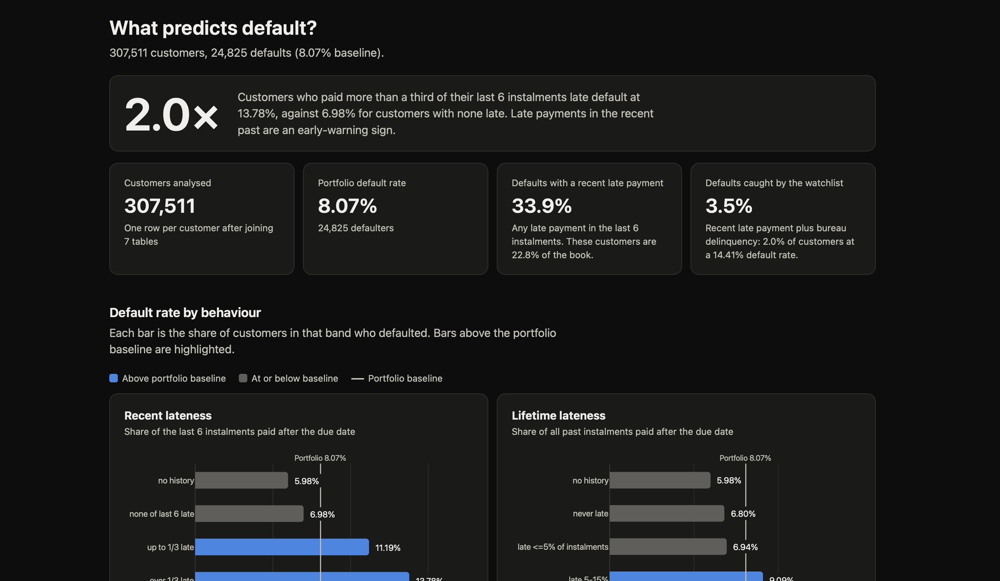
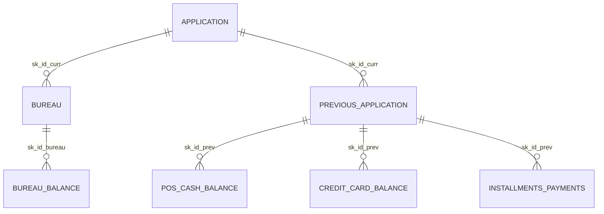

# Home Credit Default Risk: SQL analysis on 7 messy tables
Dashboard Link: https://arpitmhptr-collab.github.io/home-credit-default-risk-sql/

An end-to-end SQL project on the Kaggle [Home Credit Default Risk](https://www.kaggle.com/competitions/home-credit-default-risk) data. It joins 7 related tables (about 13.6M instalment rows and 27.3M bureau-balance rows) into one customer-level mart, runs data-quality checks and reconciliations at every step, and asks which behaviours go with default.

Stack: DuckDB (SQL, runs locally), Python (builds the dashboard only), Plotly.



## Headline findings

Baseline default rate is **8.07%** (24,825 defaults in 307,511 customers).

| Behaviour | Default rate | Lift vs baseline |
|---|---|---|
| None of last 6 instalments late | 6.98% | 0.86x |
| More than 1/3 of last 6 instalments late | 13.78% | 1.71x |
| Credit-card utilisation above 70% (16,583 customers) | 15.37% | 1.90x |
| Bureau utilisation above 70% (82,667 customers) | 10.66% | 1.32x |
| No bureau record at all (44,020 customers) | 10.12% | 1.25x |

- Recent payment behaviour separates good from bad customers by about 2x. Lifetime lateness separates them less (6.8% to 11.4%).
- A watchlist flag (late payment in the last 6 instalments **and** bureau delinquency in the last 12 months) picks out 2.0% of customers who default at 14.41%. It is precise but catches only 3.5% of all defaults, so it suits a collections watchlist, not a blanket policy.
- Customers with any late payment in the last 6 instalments are a minority of the book but a disproportionate share of defaults (exact shares on the dashboard).

Suggested action: trigger early-collections outreach or a limit review when a recent late payment coincides with high utilisation, and send applicants with no bureau record to manual review instead of declining them.

## Data quality issues found and handled

| Issue | Size | Handling |
|---|---|---|
| `DAYS_EMPLOYED = 365243` placeholder | 55,374 customers (18.0%); default rate 5.4% vs 8.66% for the rest | Flagged, cleaned column set to NULL so averages stay honest |
| `ORGANIZATION_TYPE = 'XNA'` | 55,374 rows, the same count as the placeholder | Treated as a hidden null |
| `DAYS_FIRST_DRAWING = 365243` in previous applications | 934,444 rows (56%) | Column not used |
| Non-unique key in `installments_payments` | 653,483 extra rows (partial payments repeat the instalment amount) | Collapsed to one row per instalment before any sum |
| Orphan `bureau_balance` rows | 43,041 loan IDs, 3,120,184 rows (11.4%) with no parent in `bureau` | Excluded, counted and reconciled |
| Orphan `sk_id_prev` in POS, credit card, instalments | 37,422 / 11,372 / 38,847 IDs | Instalments and cards linked through their own `sk_id_curr` so these rows are kept; POS-cash not used |
| Other oddities | 4 rows with gender `XNA`, 3 incomes above 10M | Noted, not removed |

## How fan-out was avoided

Customers have on average 5.6 bureau loans, each with 33 monthly rows, so joining raw tables would multiply a customer row by about 190. The rule used throughout: **aggregate each child table to one row per customer (or per loan) before joining.**

- `bureau_balance` is aggregated to loan level, then bureau to customer level.
- Instalments are collapsed to one row per instalment, then scored with window functions (`ROW_NUMBER`, `LAG`, a 6-row rolling average), then aggregated to customer level.
- The mart joins four one-row-per-customer feature tables to `application_train` with `LEFT JOIN`. An inner join would silently drop the 14% of customers with no bureau record.



## Reconciliation checks

Every build step has a check script (`sql/5_checks/`) comparing before and after: row counts, distinct keys, and sums of money and counts. Examples: the mart has exactly 307,511 rows with no duplicate customers; `SUM(target)` is 24,825 before and after; total amount paid is preserved through the instalment collapse; every feature total carried into the mart equals the feature table's total for train customers. The final mart script runs 13 checks, all passing.

## Repository layout

```
sql/
  1_load/            load 8 CSVs into DuckDB, verify row counts
  2_profile/         key uniqueness, nulls, odd values
  3_relationships/   one-to-many fan-out and orphan checks
  4_mart/            feature tables and the customer mart
  5_checks/          reconciliation after each build
  6_analysis/        default drivers and the dashboard data layer
dashboard/           template.html + build_dashboard.py -> index.html
docs/                ERD and screenshots
run_all.sh           rebuild everything
```

## Run it

1. Accept the competition rules on Kaggle and download the CSVs into `data/raw/`.
2. Install the DuckDB CLI, then `python3 -m venv .venv && source .venv/bin/activate && pip install duckdb`.
3. `bash run_all.sh`, then open `dashboard/index.html`.

## Limitations

- Findings are associations. Late payers may also differ in income or other traits, and no model controls for that.
- The Kaggle test set has no outcome, so all analysis uses `application_train`.
- `EXT_SOURCE_*` scores and POS-cash balances were not analysed.
